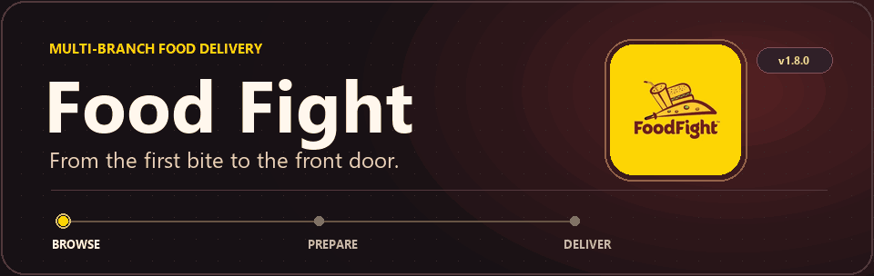
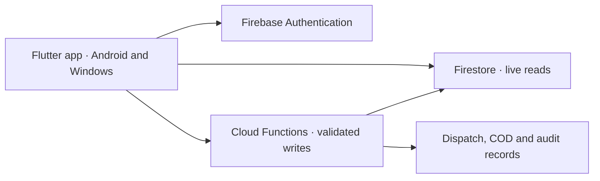

# Food Fight

<p align="center">
  <picture>
    <source media="(prefers-reduced-motion: reduce)" srcset="docs/images/food-fight-cover.png">
    
  </picture>
</p>

Food Fight connects customers, branch kitchens, and delivery riders in one Flutter app. Each account opens the workspace for its role. Branch teams manage their own menus and deliveries, while platform administrators oversee the network.

**[Download](#download)** · **[Explore the app](#explore-the-app)** · **[Run the demo](#run-the-demo)** · **[Developer guides](#developer-guides)**

## Download

| Platform | Get Food Fight v1.8.0 |
| :--- | :--- |
| **Android 7.0+** | [Download signed APK][apk] · [SHA-256 checksum][checksum] |
| **Windows x64** | [Download Food Fight Setup.exe][windows] |

Open the APK on Android and follow the system prompts. On Windows, run Setup.exe and open **Food Fight** from the Start menu. The Windows installer is unsigned.

Use **Settings → Check for Updates** in the Android app for later versions. Food Fight verifies the download checksum before opening the system installer. [Latest release][latest]

## Explore the app

| Workspace | What you can do |
| :--- | :--- |
| **Customer** | Browse the local menu, customize dishes, apply offers, place Cash on Delivery orders, track delivery, and contact support. |
| **Kitchen and branch staff** | Manage menus and offers, prepare orders, dispatch riders, handle support, and reconcile cash within branch permissions. |
| **Rider** | Respond to offers, confirm pickup and delivery, share location with permission, and record cash collection. |
| **Super admin** | Manage branches, administrators, platform settings, and audit records. |

On mobile, the storefront uses a featured menu banner, category filters, and bottom navigation. Wide desktop windows place the cart beside the menu and keep navigation in a branded sidebar. Settings offers light and dark themes plus English and Urdu, with right-to-left layout and translations across selected screens.

## Architecture



Cloud Functions validate menu availability, prices, discounts, delivery charges, and order transitions. Firestore rules scope data by account role and branch. Firebase Storage and Cloud Messaging handle media and notifications. Maps, SMS sign-in, Google sign-in, and optional Supabase image uploads require environment configuration.

The combined app starts at [`lib/main.dart`](lib/main.dart). Separate entry points exist for [customers](lib/main_customer.dart), [riders](lib/main_rider.dart), and [administrators](lib/main_admin.dart).

## Run the demo

The local demo uses Chrome and Firebase emulators with the isolated `demo-food-fight` project. Install Flutter, Chrome, Node.js 20, Firebase CLI, and Java 21 or later before running it.

<details>
<summary><strong>1. Clone and start Firebase emulators</strong></summary>

```powershell
git clone https://github.com/Ir786106/food-fight-app.git
cd food-fight-app
flutter pub get
npm --prefix functions ci

$env:FUNCTIONS_DISCOVERY_TIMEOUT = '60'
firebase emulators:start --config firebase.demo.json --project demo-food-fight --only auth,functions,firestore,storage
```

</details>

<details>
<summary><strong>2. Seed demo accounts and launch the app</strong></summary>

Open a second terminal in the repository directory.

```powershell
$env:GCLOUD_PROJECT = 'demo-food-fight'
$env:FIREBASE_AUTH_EMULATOR_HOST = '127.0.0.1:9187'
$env:FIRESTORE_EMULATOR_HOST = '127.0.0.1:8687'
node functions/seed_local_demo.js

flutter run -d chrome --web-hostname 127.0.0.1 --web-port 8101 -t lib/main_customer.dart --dart-define=FOODFIGHT_LOCAL_DEMO=true
```

| Role | Demo email | Entry point | Port |
| :--- | :--- | :--- | :--- |
| Customer | `demo-customer@example.test` | `lib/main_customer.dart` | `8101` |
| Kitchen admin | `demo-admin@example.test` | `lib/main_admin.dart` | `8103` |
| Rider | `demo-rider@example.test` | `lib/main_rider.dart` | `8102` |

All three emulator-only accounts use `FoodFight-Demo-123`. Use the corresponding entry point and port when launching each role.

</details>

## Developer guides

| Guide | Covers |
| :--- | :--- |
| [Environment setup](docs/ENVIRONMENT_SETUP.md) | Firebase registrations, restricted Maps keys, and optional integrations |
| [Architecture decisions](docs/ARCHITECTURE_DECISIONS.md) · [API](docs/API.md) · [Database](docs/DATABASE.md) | Integration boundaries, callable functions, and data ownership |
| [Testing](docs/TESTING.md) · [Project progress](docs/PROGRESS.md) | Automated checks and remaining staging verification |
| [Deployment](docs/DEPLOYMENT.md) · [Windows installer workflow](.github/workflows/windows-installer.yml) | Build, package, and publish releases |
| [Security](SECURITY.md) | Reporting and security policy |

<details>
<summary><strong>Run the development checks</strong></summary>

```powershell
flutter analyze --no-fatal-infos
flutter test
node --test functions/checkout.test.js functions/signed_image_upload.test.js
```

Publish Android updates with the existing release key and the matching `.apk.sha256` asset. Attach the Windows x64 setup to the same release. See the [Android release procedure](docs/DEPLOYMENT.md#publish-an-android-update) for versioning and update checks.

</details>

Maintained by [Muhammad Irfan Waseem](https://github.com/Ir786106).

[apk]: https://github.com/Ir786106/food-fight-app/releases/download/v1.8.0/FoodFight_v1.8.0_release.apk
[checksum]: https://github.com/Ir786106/food-fight-app/releases/download/v1.8.0/FoodFight_v1.8.0_release.apk.sha256
[windows]: https://github.com/Ir786106/food-fight-app/releases/download/v1.8.0/FoodFight-1.8.0-Windows-x64-Setup.exe
[latest]: https://github.com/Ir786106/food-fight-app/releases/latest
