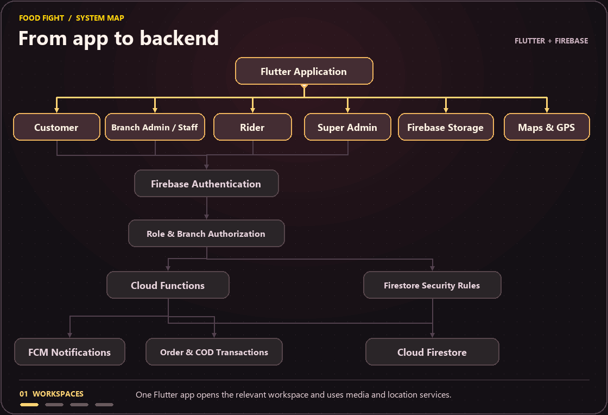
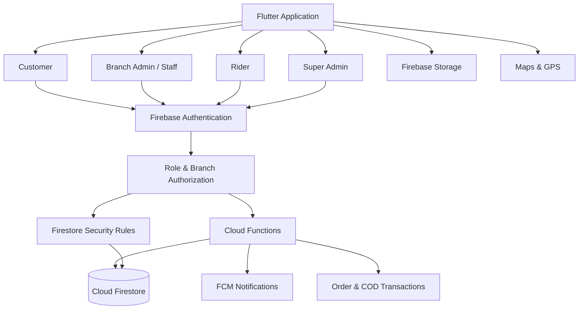

# Food Fight

<p align="center">
  <picture>
    <source media="(prefers-reduced-motion: reduce)" srcset="docs/images/food-fight-cover.png">
    
  </picture>
</p>

Food Fight connects customers, branch kitchens, and delivery riders in one Flutter app. Each account opens the workspace for its role. Branch teams manage their own menus and deliveries, while platform administrators oversee the network.

**[Download](#download)** · **[Explore the app](#explore-the-app)** · **[Watch the architecture](#architecture)** · **[Run the demo](#run-the-demo)** · **[Developer guides](#developer-guides)**

## Download

| Platform | Get Food Fight v1.8.0 |
| :--- | :--- |
| **Android 7.0+** | [Download signed APK][apk] · [SHA-256 checksum][checksum] |
| **Windows x64** | [Download Food Fight Setup.exe][windows] |

Open the APK on Android and follow the system prompts. On Windows, run Setup.exe and open **Food Fight** from the Start menu. The Windows installer is unsigned.

Use **Settings → Check for Updates** in the Android app for later versions. Food Fight verifies the download checksum before opening the system installer. [Latest release][latest]

## Explore the app

| Workspace | What you can do |
| :--- | :--- |
| **Customer** | Browse the local menu, customize dishes, apply offers, place Cash on Delivery orders, track delivery, and contact support. |
| **Kitchen and branch staff** | Manage menus and offers, prepare orders, dispatch riders, handle support, and reconcile cash within branch permissions. |
| **Rider** | Respond to offers, confirm pickup and delivery, share location with permission, and record cash collection. |
| **Super admin** | Manage branches, administrators, platform settings, and audit records. |

On mobile, the storefront uses a featured menu banner, category filters, and bottom navigation. Wide desktop windows place the cart beside the menu and keep navigation in a branded sidebar. Settings offers light and dark themes plus English and Urdu, with right-to-left layout and translations across selected screens.

## Architecture

<p align="center">
  <picture>
    <source media="(prefers-reduced-motion: reduce)" srcset="docs/images/food-fight-architecture.png">
    
  </picture>
</p>

The animation follows four stages. Flutter opens the workspace for the signed-in role, Firebase Authentication establishes the user’s identity, role and branch checks gate access, and backend operations update data and notify users.

| Path | What it handles |
| :--- | :--- |
| **Cloud Functions → Firestore** | Server-authorized checkout, order transitions, rider offers, and Cash on Delivery transactions. |
| **Flutter → Firestore rules → Firestore** | Scoped client reads and permitted direct writes. Rules evaluate ownership, assignment, branch, and role permissions. |
| **Cloud Functions → FCM** | Push notifications alongside the app’s Firestore inbox. |
| **Flutter → Storage and Maps** | Media access, delivery location selection, and rider tracking on configured platforms. |

The authorization node represents checks in Cloud Functions and Firestore rules. It is a conceptual boundary. Firebase Authentication establishes identity, and backend checks determine which actions that identity can perform.

<details>
<summary><strong>View or copy the Mermaid diagram</strong></summary>



</details>

Flutter keeps Provider and ChangeNotifier for session and feature state. Named routes in `lib/routes` apply role guards. New feature code can live under `lib/features/<role>`, with reusable UI under `lib/core/design_system` and shared data access under `lib/shared/repositories`. Existing screens, models, providers, and services retain their paths as features migrate. The menu-report route is an example of a feature module using a shared repository.

Firebase Auth identifies accounts, Firestore stores business data, and Cloud Functions validate privileged operations. Firebase Messaging delivers push alerts. The signed Supabase upload path is for images. Existing Firebase Storage media URLs remain readable. See the [environment setup guide](docs/ENVIRONMENT_SETUP.md) and [example settings](.env.example) for client configuration. Keep the Supabase service-role credential in the Cloud Functions secret store.

## How an order moves

1. **Choose a branch and build the cart.** The customer selects a delivery area and adds dishes, variants, and add-ons.
2. **Confirm the server quote.** `quoteOrder` validates catalog prices, availability, delivery charges, and discounts. `placeOrder` revalidates the accepted total before committing the order. Reusing the same request ID for the same checkout can return the existing order.
3. **Prepare and dispatch.** Kitchen staff accept, prepare, and mark the order ready. Staff can assign a rider manually. Branches with automatic dispatch enabled can offer the delivery to an eligible online rider.
4. **Deliver and settle cash.** The rider confirms pickup and delivery. The server records COD collection, and branch staff can confirm the cash handover.

Checkout currently supports Cash on Delivery. Maps, SMS sign-in, Google sign-in, push delivery, and optional Supabase image uploads depend on environment and platform configuration.

<details>
<summary><strong>Find the implementation in the repository</strong></summary>

| Source | Responsibility |
| :--- | :--- |
| [Flutter entry](lib/main.dart) · [Customer](lib/main_customer.dart) · [Rider](lib/main_rider.dart) · [Admin](lib/main_admin.dart) | Shared startup and role-specific app editions |
| [Backend functions](functions/index.js) · [Order lifecycle](functions/order_lifecycle.js) | Checkout, provisioning, order mutations, dispatch, notifications, and settlement |
| [Firestore rules](firestore.rules) · [Storage rules](storage.rules) · [Indexes](firestore.indexes.json) | Client access controls and query indexes |
| [Staging verification](docs/STAGING_VERIFICATION.md) · [Release preparation](docs/RELEASE_PREPARATION.md) | Tenant backfill, access checks, builds and release gates |
| [Data contracts](docs/DATABASE.md) · [API guide](docs/API.md) | Document shapes, collections, and callable interfaces |

</details>

## Run the demo

The local demo uses Chrome and Firebase emulators with the isolated `demo-food-fight` project. Install Flutter, Chrome, Node.js 20, Firebase CLI, and Java 21 or later before running it.

<details>
<summary><strong>1. Clone and start Firebase emulators</strong></summary>

```powershell
git clone https://github.com/Ir786106/food-fight-app.git
cd food-fight-app
flutter pub get
npm --prefix functions ci

$env:FUNCTIONS_DISCOVERY_TIMEOUT = '60'
firebase emulators:start --config firebase.demo.json --project demo-food-fight --only auth,functions,firestore,storage
```

</details>

<details>
<summary><strong>2. Seed demo accounts and launch the app</strong></summary>

Open a second terminal in the repository directory.

```powershell
$env:GCLOUD_PROJECT = 'demo-food-fight'
$env:FIREBASE_AUTH_EMULATOR_HOST = '127.0.0.1:9187'
$env:FIRESTORE_EMULATOR_HOST = '127.0.0.1:8687'
$env:FOOD_FIGHT_DEMO_PASSWORD = Read-Host -MaskInput 'Set an emulator-only password (12+ characters)'
node functions/seed_local_demo.js

flutter run -d chrome --web-hostname 127.0.0.1 --web-port 8101 -t lib/main_customer.dart --dart-define=FOODFIGHT_LOCAL_DEMO=true
```

| Role | Demo email | Entry point | Port |
| :--- | :--- | :--- | :--- |
| Customer | `demo-customer@example.test` | `lib/main_customer.dart` | `8101` |
| Kitchen admin | `demo-admin@example.test` | `lib/main_admin.dart` | `8103` |
| Rider | `demo-rider@example.test` | `lib/main_rider.dart` | `8102` |
| Super Admin | `demo-super-admin@example.test` | `lib/main_admin.dart` | `8103` |

All four emulator-only accounts use `the value of FOOD_FIGHT_DEMO_PASSWORD`. Use the corresponding entry point and port when launching each role.

</details>

## Role QA checklist

Use separate test accounts in the local demo or staging. Exercise a narrow phone layout and a desktop layout, light and dark themes, and large text. Check Urdu direction and translated labels where supported.

| Role | Manual checks |
| :--- | :--- |
| Customer | Select a branch, customize two identical dishes with different instructions, apply a coupon, confirm the COD quote, track the order, reorder, and submit a menu report. Change the default address and verify another account cannot access it. |
| Rider | Go online, accept an offer before expiry, complete pickup and COD handover, and check the Completed tab. Reopen the app mid-delivery and test GPS denial. Verify a rider cannot view another rider's private profile. |
| Branch admin and staff | Compare two branch accounts. Refresh Orders, assign an in-branch rider, settle COD, apply a menu availability change, and export a report. Verify a limited staff account cannot mutate another branch's promotions or read private customer records. Resolve a menu issue report from your branch. |
| Super Admin | Provision a staff login, complete password setup, suspend and reactivate it, and verify the audit trail. Suspend a branch, confirm that new checkout is denied, then reactivate it. Check the user directory filters and branch preview. |

### Rules and rollout checks

- Verify that privileged Auth UIDs have matching active Firestore user profiles before enabling the updated rules.
- Add the declared indexes before releasing clients that use the menu-report and customer-review queries. Review legacy branch-owned records with missing scope and assign a branch only when ownership is known. Shared catalog records remain readable and require Super Admin to edit.
- Deploy Functions, Firestore rules, and client updates together in staging. Run role QA and replay the [emulator tests](docs/TESTING.md) before promotion.
- Deploy the rider earnings index before publishing the client. Older active orders without `status` need a verified status backfill to appear outside the recent history window. Older delivered orders without a Firestore timestamp in `updatedAt` need a verified timestamp backfill to count toward earnings.
- Platform restaurant catalog writes require Super Admin access. Populate the catalog through an authorized seed or import. Existing restaurant documents and public reads are preserved.
- The delivery waitlist component reports write failures. It remains unused in the app and requires a secured backend before activation.
- The Admin customer directory derives branch scope from the signed-in staff profile. It shows up to 100 branch-registered customers and customers found in the latest 300 branch orders. Pull to refresh for current results. Branch account restrictions apply to new checkouts at that branch. Platform account blocks remain global.
- Deploy the customer management and checkout Functions before shipping the updated Admin client. Coordinate the rules cutover with the Admin client rollout. Older Admin clients lose their direct customer-directory access when the new rules take effect. Existing customer documents and orders are retained, and historical platform blocks keep applying until reviewed by a Super Admin.
- Remaining architecture work includes broader Urdu coverage and completing tenant isolation for other legacy collections.
- Staff access to chats, menu reports, rider assignments, audit logs, and review moderation requires a concrete matching branch. Review records with an empty branch or `all` in staging and backfill only where ownership is known. Customer-owned chats remain accessible to their owners.

## Developer guides

| Guide | Covers |
| :--- | :--- |
| [Environment setup](docs/ENVIRONMENT_SETUP.md) | Firebase registrations, restricted Maps keys, and optional integrations |
| [Architecture decisions](docs/ARCHITECTURE_DECISIONS.md) · [API](docs/API.md) · [Database](docs/DATABASE.md) | Integration boundaries, callable functions, and data ownership |
| [Testing](docs/TESTING.md) · [Project progress](docs/PROGRESS.md) | Automated checks and remaining staging verification |
| [Deployment](docs/DEPLOYMENT.md) · [Windows installer workflow](.github/workflows/windows-installer.yml) | Build, package, and publish releases |
| [Security](SECURITY.md) | Reporting and security policy |

<details>
<summary><strong>Run the development checks</strong></summary>

```powershell
flutter analyze --no-fatal-infos
flutter test
node --test functions/checkout.test.js functions/signed_image_upload.test.js
```

Publish Android updates with the existing release key and the matching `.apk.sha256` asset. Attach the Windows x64 setup to the same release. See the [Android release procedure](docs/DEPLOYMENT.md#publish-an-android-update) for versioning and update checks.

</details>

Maintained by [Muhammad Irfan Waseem](https://github.com/Ir786106).

[apk]: https://github.com/Ir786106/food-fight-app/releases/download/v1.8.0/FoodFight_v1.8.0_release.apk
[checksum]: https://github.com/Ir786106/food-fight-app/releases/download/v1.8.0/FoodFight_v1.8.0_release.apk.sha256
[windows]: https://github.com/Ir786106/food-fight-app/releases/download/v1.8.0/FoodFight-1.8.0-Windows-x64-Setup.exe
[latest]: https://github.com/Ir786106/food-fight-app/releases/latest
