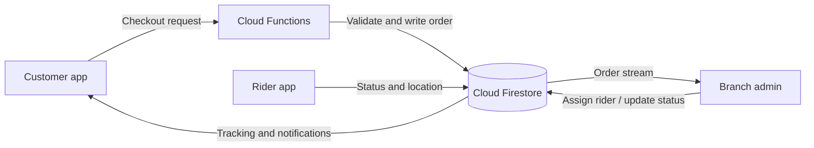

# Food Fight

Food Fight is a Flutter application for multi-branch food ordering and restaurant operations. It provides customer ordering and support, branch-level administration, platform administration, and a rider console, backed by Firebase services.

**Highlights**

- Role-aware customer, admin, sub-admin/staff, super-admin, and rider experiences.
- Branch-aware menu discovery, ordering, administration, and delivery workflows.
- Firestore-backed orders, reviews, support conversations, notifications, and rider tracking.
- Responsive layouts, light/dark themes, and reusable design tokens.
- Cash on Delivery is the active checkout method. Saved wallet numbers are references only; the app does not process card or wallet payments.

## Screenshots

No application screenshots are currently included. Add reviewed PNG or JPEG captures to [`docs/screenshots/`](docs/screenshots/), then link them here with descriptive alt text. Do not add customer information, tokens, or other private data to screenshots.

| Screen | Preview |
| --- | --- |
| Customer storefront | _Screenshot not yet available_ |
| Order tracking | _Screenshot not yet available_ |
| Admin dashboard | _Screenshot not yet available_ |


## Table of Contents

1. [Features](#1-features)
2. [Tech Stack](#2-tech-stack)
3. [Architecture](#3-architecture)
4. [Data Model](#4-data-model)
5. [Security](#5-security)
6. [Getting Started](#6-getting-started)
7. [Running, Testing and Quality](#7-running-testing-and-quality)
8. [Building and Release](#8-building-and-release)
9. [Performance and Responsive Design](#9-performance-and-responsive-design)
10. [Troubleshooting and FAQ](#10-troubleshooting-and-faq)
11. [Known Limitations and Roadmap](#11-known-limitations-and-roadmap)
12. [Contributing](#12-contributing)
13. [License, Author and Contact](#13-license-author-and-contact)

## 1. Features

| Role | Implemented capabilities |
| --- | --- |
| **Customer** | Email/password and Google sign-in; onboarding; branch-aware restaurant, menu, and food discovery; search and filters; food details with variants, add-ons, and order notes; favorites; cart; coupons and loyalty tokens; address management; Cash on Delivery checkout; order history and status tracking; reviews; support chat with image attachments; in-app notifications and FCM integration; profile, settings, and light/dark theme. |
| **Admin** | Branch dashboard and order handling; menu, category, option-template, deal, coupon, and delivery-area management; customer and rider management; support chat and review moderation; sales reports with CSV export. |
| **Sub-admin / staff** | Admin routes and actions are guarded by role and, where configured, granular permissions. The available permissions are evaluated against the assigned user record and Firestore rules. |
| **Super-admin** | Platform dashboard, branch and admin management, global settings, audit-log access, and platform-level administration. |
| **Rider** | Assigned delivery queue, order status updates, and device-location reporting for order tracking. |

Feature availability depends on account role, permissions, branch assignment, device permissions, Firebase configuration, and deployed backend rules.

## 2. Tech Stack

| Area | Technology |
| --- | --- |
| UI and runtime | Flutter; `pubspec.yaml` declares Dart `>=3.0.0 <4.0.0`. Cleanup validation used Flutter 3.47.2 and Dart 3.13.2. |
| State management | Provider (`ChangeNotifier` providers registered in `lib/main.dart`). |
| Authentication and data | Firebase Authentication, Cloud Firestore, Firebase Storage, Firebase Cloud Messaging, and Firebase App Check. |
| Server-side operations | Firebase Cloud Functions, Node.js 20, Firebase Admin SDK, and Firebase Functions SDK. |
| Maps and location | `google_maps_flutter`, `geolocator`. Google Maps keys must be separately configured and restricted. |
| Image storage | Firebase Storage is the configured active upload provider. Supabase and Cloudinary adapters remain in the codebase for optional/legacy storage paths. |
| Charts and reporting | `fl_chart`, `csv`. |
| Responsive testing | Widget tests include a 10-size viewport matrix with text scales of 1.0, 1.3, and 2.0. |

### Flutter packages

Versions below are the constraints declared in `pubspec.yaml`, not a guarantee that each package's newest release is installed.

| Package | Version constraint | Purpose |
| --- | --- | --- |
| `cupertino_icons` | `^1.0.6` | Cupertino icon font. |
| `provider` | `^6.1.2` | Application state and dependency access. |
| `shared_preferences` | `^2.2.3` | Small local preferences such as onboarding state. |
| `google_fonts` | `^6.2.1` | Theme typography. |
| `firebase_core` | `^3.10.0` | Firebase initialization. |
| `firebase_auth` | `^5.3.0` | User authentication. |
| `cloud_firestore` | `^5.0.0` | Application database and real-time streams. |
| `firebase_storage` | `^12.3.7` | Active image storage provider. |
| `firebase_messaging` | `^15.1.0` | Push notifications. |
| `firebase_app_check` | `^0.3.1+4` | Firebase App Check integration. |
| `google_sign_in` | `^6.2.2` | Google authentication. |
| `supabase_flutter` | `^2.17.2` | Optional Supabase storage integration and legacy media resolution. |
| `flutter_secure_storage` | `^9.2.2` | Secure device-local storage. |
| `image_picker` | `^1.1.2` | Image selection. |
| `cached_network_image` | `^3.4.1` | Cached remote images. |
| `image` | `^4.1.0` | Image manipulation. |
| `uuid` | `^4.5.0` | Identifier generation. |
| `path` | `^1.9.0` | Path utilities. |
| `fl_chart` | `^0.68.0` | Admin charts. |
| `geolocator` | `^13.0.2` | Device location and permission handling. |
| `google_maps_flutter` | `^2.9.0` | Map surfaces. |
| `shimmer` | `^3.0.0` | Loading placeholders. |
| `dio` | `^5.7.0` | HTTP client. |
| `path_provider` | `^2.1.4` | Platform file locations. |
| `url_launcher` | `^6.3.0` | External links and platform actions. |
| `intl` | `^0.19.0` | Date and number formatting. |
| `csv` | `^6.0.0` | CSV report generation. |
| `package_info_plus` | `^9.0.1` | Installed application metadata. |
| `open_filex` | `^4.7.0` | Opening local files. |
| `crypto` | `^3.0.7` | Cryptographic utilities used by application helpers. |
| `share_plus` | `^12.0.2` | Native share sheet. |

Development dependencies are `flutter_test`, `flutter_lints` (`^4.0.0`), and `flutter_launcher_icons` (`^0.14.4`).

### Cloud Functions packages

`functions/package.json` targets Node.js 20 and declares `firebase-admin`, `firebase-functions`, `@sendgrid/mail`, and `twilio`. Email and SMS dispatch require configured provider credentials. The unused `nodemailer` dependency has been removed.

## 3. Architecture

### Source layout

```text
lib/
├── core/          # Bootstrap, configuration, constants, errors, networking, responsive helpers
├── models/        # Firestore/application data models
├── providers/     # Provider state and stream coordination
├── routes/        # Named routes, role routing, and route guards
├── screens/       # Customer, admin, super-admin, rider, and shared screens
├── services/      # Firebase, storage, domain, and reporting operations
├── theme/         # Customer/admin themes and theme state
├── widgets/       # Shared and feature-specific UI components
├── firebase_options.dart
└── main.dart

functions/         # Node.js Firebase Cloud Functions
tool/              # Developer-only data seeding and migration helpers
test/              # Unit, widget, flow, and responsive tests
assets/            # App images and branding
```

### Data flow



### Routing, state, and shared UI

- `AppRoutes` defines named application routes. `RoleRouter` resolves canonical home routes for customer, admin/staff, super-admin, and rider accounts. Route guards are in `app_routes.dart`.
- Providers are registered in `main.dart`; screens consume them through Provider.
- Customer, admin, and super-admin themes are defined under `lib/theme/` and `lib/core/theme/`. Shared color, spacing, and responsive helpers are under `lib/core/`.
- `WindowSizeClass` uses compact `<600 dp`, medium `600–839 dp`, expanded `840–1199 dp`, and large `>=1200 dp` widths. Individual screens may use additional layout decisions.
- `AppLogger`, `AppException`, and safe conversion helpers are used for logging, surfaced errors, and model parsing. `AppBootstrap` starts App Check, Supabase, and messaging setup without blocking the first frame.

## 4. Data Model

Collection names below are based on the Firestore constants, service queries, and deployed rules. The application also contains legacy aliases in rules; keep those until the corresponding data and queries are migrated.

| Collection / path | Representative data |
| --- | --- |
| `users/{uid}` | Name, email, phone, role, status, branch, permissions, profile image, timestamps. |
| `users/{uid}/payment_methods/{methodId}` | Saved method metadata and optional wallet account reference. The current screen only adds JazzCash/Easypaisa references. |
| `branches/{branchId}` | Branch details, active status, location, and operational aggregates. |
| `restaurants/{restaurantId}` | Restaurant information and branch association. |
| `categories/{categoryId}`, `menuItems/{itemId}` | Category/menu metadata, price, options, availability, branch, and review aggregates. |
| `orders/{orderId}` | Customer, branch, items, totals, payment label, delivery address, rider, status, and timestamps. |
| `orders/{orderId}/tracking/{trackingId}` and `rider_locations/{riderId}` | Rider location and tracking updates. |
| `addresses`, `deliveryAreas`, `riders`, `riderAssignments` | Customer delivery data and rider operations. |
| `coupons`, `deals`, `option_templates` / `optionTemplates` | Discounts, promotions, and reusable menu options. |
| `reviews`, `favorites`, `notifications` | Customer feedback, saved items, and user notifications. |
| `loyaltyAccounts` / `loyalty_accounts`, `loyaltyTransactions` / `loyalty_transactions` | Loyalty balances and transaction history. |
| `chats/{chatId}/messages/{messageId}` | Support conversations and messages. |
| `settings`, `auditLogs` | Global configuration and administrative audit events. |

Important shared fields include `id`, `createdAt`, `updatedAt`, `status`, `isActive`, `userId`, `customerId`, `branchId`, `role`, `permissions`, and `items`. Exact serialization is defined in the models and service layer; do not infer an exhaustive schema from this summary.

### Order status lifecycle

```text
pending → accepted → preparing → ready → assigned → pickedUp → outForDelivery → delivered
    └──────────────────────────────────────────────────────────────────────→ cancelled
```

The `OrderStatus` model also includes cancellation. Actual permitted transitions are subject to the deployed Firestore rules and Cloud Functions.

### Role and permission overview

| Role | Application scope |
| --- | --- |
| Customer | Own profile, addresses, saved methods, orders, reviews, favorites, notifications, and loyalty data as permitted by rules. |
| Admin | Branch operations and branch-scoped records; super-admin and permission checks may grant broader operations. |
| Sub-admin / staff | Branch operations controlled by assigned permissions and route guards. |
| Super-admin | Platform-level administration and role-management operations. |
| Rider | Rider console, assigned work, and delivery-location updates. |

The role matrix is a summary only. Firestore and Storage rules are authoritative; review them before deploying changes.

## 5. Security

- Firestore rules require authentication for protected operations and implement role, ownership, permission, and branch checks for supported paths.
- Storage rules allow public reads for selected images and constrain writes by role, image content type, and size. Unmatched paths are denied except for the super-admin rule.
- Saved payment-method documents are owner-only. The application does not collect full card numbers or CVV. Wallet numbers saved as references are personal data stored under the user's payment-method subcollection; no card or wallet transaction is processed by the app.
- Firebase client configuration is generated in `lib/firebase_options.dart` and platform config files. These client identifiers are not substitutes for security rules. Do not commit service-account keys, signing credentials, private keys, or real environment files.
- Google Maps keys are supplied through ignored local runtime configuration (`android/local.properties` and `web/maps-config.js`). Restrict them by Android package/signing certificate and web referrer, and rotate keys that were previously exposed.
- Cloud Function provider secrets must be injected into the server-side runtime; do not place them in Flutter client code or `.env.example`.

See [SECURITY.md](SECURITY.md) for vulnerability reporting.

## 6. Getting Started

### Prerequisites

- Flutter and Dart. The package declares Dart `>=3.0.0 <4.0.0`; the current validation environment used Flutter 3.47.2 / Dart 3.13.2.
- Android Studio and Android SDK for Android development; Xcode on macOS for iOS development.
- Node.js 20 and npm for `functions/`.
- Firebase CLI and FlutterFire CLI for project configuration and deployment.

### Clone and install

```powershell
git clone <repository-url>
cd food_fight
flutter pub get
```

Replace `<repository-url>` with the repository URL. Clone and setup commands are environment-specific and must be run by the owner.

### Firebase setup

1. Create or select a Firebase project and register each platform application that will be built.
2. Enable the Firebase Authentication providers used by the app (email/password and Google).
3. Enable Cloud Firestore, Firebase Storage, Cloud Messaging, App Check, and Cloud Functions as required by the target environment.
4. Install and authenticate the Firebase CLI and FlutterFire CLI, then configure the Flutter app:

   ```powershell
   dart pub global activate flutterfire_cli
   flutterfire configure
   ```

5. Keep generated `lib/firebase_options.dart` and platform Firebase configuration in the local build environment. Do not replace the existing project configuration without confirming the intended Firebase project.
6. Install function dependencies and deploy only after reviewing the target project and rules:

   ```powershell
   Set-Location functions
   npm ci
   Set-Location ..
   firebase deploy --only firestore,storage
   firebase deploy --only functions
   ```

   Firebase CLI login, project selection, provider enablement, and deployment were not performed as part of this cleanup.

### Runtime configuration

- `.env.example` documents optional `SUPABASE_URL`, `SUPABASE_PUBLISHABLE_KEY`, `CLOUDINARY_CLOUD_NAME`, and `CLOUDINARY_UPLOAD_PRESET` values. Flutter does **not** automatically load `.env`; supply Dart defines when using the optional integrations. Firebase Storage is the default upload provider.
- Android Google Maps: set `GOOGLE_MAPS_API_KEY` in the ignored `android/local.properties`. The Android manifest placeholder reads this value at build time.
- Web Google Maps: create ignored `web/maps-config.js` containing `window.foodFightGoogleMapsApiKey = 'YOUR_RESTRICTED_KEY';`.
- Cloud Functions read `SENDGRID_API_KEY`, `TWILIO_SID`, `TWILIO_TOKEN`, and `TWILIO_FROM` from `process.env`. This repository does not declare Secret Manager bindings; the deployment owner must configure secure runtime injection before enabling email or SMS.
- Do not put private provider secrets in a Flutter `--dart-define`; values compiled into a client application can be extracted.

### First super-admin account

There is no public client-side super-admin bootstrap flow. Create the initial account through a trusted, owner-controlled Firebase Admin SDK procedure, then verify its Firestore user record and custom claims. The callable `setUserRole` requires an existing super-admin and cannot bootstrap the first one.

### Initial data

Developer data seeding and migration helpers are kept under `tool/` rather than the production `lib/` tree. They are not configured as standalone commands in this repository. Run them only through an owner-reviewed, authenticated development harness against the intended Firebase project; back up data first.

## 7. Running, Testing and Quality

```powershell
flutter run
flutter analyze
flutter test
dart format lib test tool
```

Run commands from the project root. Formatting changes files; review its diff before accepting it. The repository uses `flutter_lints` through `analysis_options.yaml`.

### Manual QA checklist

- **Customer:** sign up/sign in; browse and search; select branch; configure a dish; edit cart; apply coupon/tokens; complete COD checkout; review order history/tracking; submit a review; test support chat, image attachment, address, notification, and theme settings.
- **Rider:** sign in with a rider account; verify location permission handling; confirm assigned deliveries and allowed status updates; verify tracking updates on a second signed-in device.
- **Admin / sub-admin:** verify branch scope and permission gates; process orders; manage menu, options, deals, coupons, delivery areas, riders, reviews, chats, and CSV reports.
- **Super-admin:** verify dashboards, branch/admin management, system settings, role assignment, and audit-log access.
- Repeat on compact phone, tablet, and desktop widths; verify maps, uploads, FCM, and rule-denied operations against the configured Firebase project.

## 8. Building and Release

```powershell
flutter build apk --debug
flutter build apk --release
flutter build appbundle --release
flutter build web --release
```

For iOS, run `flutter build ios --release` on macOS with Xcode and Apple signing configured. Build commands for iOS and release targets are platform-dependent and were not verified on this Windows environment.

- Android `minSdk` is explicitly 24. `targetSdk` and `compileSdk` follow the installed Flutter Android toolchain values.
- Android release signing reads `android/key.properties` and a local keystore. Release builds intentionally fail if the configured keystore is unavailable. Keep both files out of version control and never include them in a report or artifact.
- `pubspec.yaml` is the single source of truth for release versioning: `version: x.y.z+build`.

Release checklist:

1. Confirm Firebase project, Maps restrictions, provider secrets, rules, indexes, and Storage policy.
2. Update `pubspec.yaml`, run `flutter pub get`, and review the generated lockfile diff.
3. Run analysis, tests, platform-specific smoke tests, and a signed build.
4. Verify permissions, deep links, notifications, maps, image uploads, and payment copy.
5. Archive/sign artifacts using the owner-controlled release keystore; do not commit build outputs.

## 9. Performance and Responsive Design

- App bootstrap work for App Check, Supabase, and FCM is initiated in the background with task timeouts, avoiding a wait for all integrations before the first frame.
- Remote images use a shared image widget and cached-network-image integration.
- Responsive size classes use 600, 840, and 1200 dp boundaries. The responsive device-matrix test declares ten viewport sizes from 320×568 through 1920×1080 at 1.0×, 1.3×, and 2.0× text scales.
- Admin layouts and chat surfaces adapt between narrow and wide windows. Verify screens with real devices and assistive text sizes; the test matrix does not represent a certification of every screen or device.

## 10. Troubleshooting and FAQ

| Symptom | Checks |
| --- | --- |
| Firebase initialization fails | Confirm the generated options match the selected Firebase project, platform app registrations exist, and required platform config is available locally. |
| Firestore reports a missing index | Use the error's index link to inspect the required query, review it, then update/deploy `firestore.indexes.json`. |
| Web map is blank | Confirm `web/maps-config.js` exists, the key is enabled for Maps JavaScript API, and HTTP referrer restrictions include the current host. |
| Android map is blank | Confirm `GOOGLE_MAPS_API_KEY` is set in ignored `android/local.properties`, rebuild, enable Maps SDK for Android, and restrict key by app identity. |
| Location is unavailable | Check device location services, platform permissions, and user permission state. Location-dependent features cannot return a live position when permission is denied. |
| Image upload fails | Verify Firebase Storage is enabled and deployed Storage rules allow the authenticated role, MIME type, and file size. For a selected optional provider, verify its runtime configuration too. |
| FCM is not received | Check platform notification permissions, Firebase Messaging setup, token registration, and the app's foreground/background handling. |
| Email/SMS is not received | Configure the relevant Firebase Function secrets and verify provider account status. Unconfigured providers do not send notifications. |
| Release build cannot sign | Configure the local release keystore and matching `android/key.properties`; do not use debug signing for release. |

## 11. Known Limitations and Roadmap

- Cash on Delivery is the only active checkout payment method. Saved wallet references do not initiate or settle payments; card and wallet gateway integration remains future work.
- The first super-admin must be provisioned through a trusted Admin SDK operation.
- Email and SMS require external provider configuration. Push notification delivery also depends on Firebase/platform configuration.
- Google Maps runtime keys are local configuration and must be supplied and restricted per platform.
- The web tracking view displays live coordinates but does not render a road map or calculate an ETA. Native Google Maps is used on mobile.
- Android still uses the default application ID `com.example.food_fight`; choose the production identifier before store distribution.
- Developer data-seeding utilities are not packaged as a turnkey command; an owner-reviewed authenticated harness is still required.
- Branch count, prices, and menu content are backend data and are not guaranteed by the Flutter client.
- Linux scaffolding exists, but its Firebase configuration and complete runtime support were not verified during cleanup.

## 12. Contributing

1. Create a focused branch such as `fix/order-status` or `docs/setup-guide`.
2. Keep changes scoped and avoid committing generated output, `.env` files, Firebase service accounts, Maps keys, or signing material.
3. Follow the existing Dart style and lint configuration. Use imperative commit subjects, for example `fix: guard rider location updates`.
4. Before opening a pull request, run `flutter analyze` and relevant tests; include manual QA details for platform-dependent changes.
5. Review Firestore/Storage rule and index changes together with the code that requires them.

## 13. License, Author and Contact

No `LICENSE` file is currently present. The project owner must select a license before redistribution terms can be stated.

- **Author:** Muhammad Irfan Waseem
- **Portfolio:** [Muhammad Irfan Waseem](https://ir786106.github.io/Muhammad_Irfan_Waseem_Portfolio)
- **GitHub:** [@Ir786106](https://github.com/Ir786106)
- **Contact:** [muhammadirfan.infosec@gmail.com](mailto:muhammadirfan.infosec@gmail.com)
